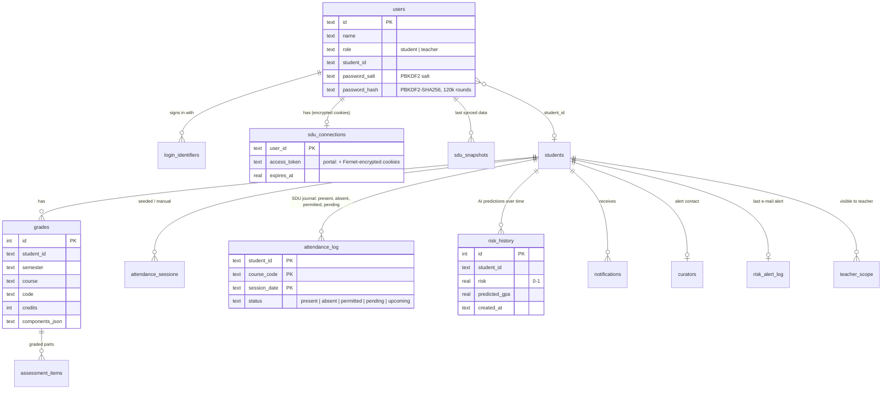

# Database

One code path, two engines: **SQLite** for local work and **PostgreSQL (Neon)** in production. The engine is chosen by the `DATABASE_URL` environment variable (set it in the host's settings or in a local `.env`, see `.env.example`): empty → SQLite file, set → Postgres. `backend/app/db.py` translates the SQL dialect on the fly, and the whole test-suite is run on both (`TEST_DATABASE_URL=postgresql://… python -m pytest`).

## How the data is accessed (be precise about this)
There is **no ORM** (not SQLAlchemy). `backend/app/repository.py` uses plain SQL with **bound parameters** (`WHERE id = ?`), never string concatenation of user input, so SQL injection is not possible through values. The few f-strings in the SQL only insert a list of `?` placeholders or a table name taken from a fixed internal list.

## Entity-relationship diagram (core tables)

The full schema (30 tables including goals, support tickets and password reset) is created by `SQLiteRepository` in `repository.py` and `monitoring_store.py`.

## The "grey zone": `pending`
SDU shows hours the teacher has not marked yet as "Not submitted". They are **not absences**. The scraper (`sdu_portal.parse_journal_sessions`) stores each class hour with its own status in **`attendance_log`**: `present`, `absent`, `permitted`, **`pending`** (a past hour nobody marked yet) or `upcoming` (still ahead). The older `attendance_sessions` table (seeded demo data) only allows present / excused / absent, which is why pending lives in the new table.

```sql
-- the grey zone, per course
SELECT course_code, COUNT(*) AS pending_hours
FROM attendance_log WHERE status = 'pending' GROUP BY course_code;
```

## Names you may be asked about
| Usual name | Here | Note |
|---|---|---|
| `users` | `users` + `login_identifiers` | e-mails / student numbers are in `login_identifiers` |
| `courses` | no table | a course is a row of `grades` (`course`, `code`, `credits`); the teacher link is `teacher_scope` |
| `attendance` | `attendance_log` (SDU, with `pending`) and `attendance_sessions` (seeded) | |
| `grades` | `grades` + `assessment_items` | graded parts of each course |
| `predictions` | `risk_history` | risk 0-1 and predicted GPA, one row per check |
| `sdu_session_token` | `sdu_connections.access_token` | |

## Security
* **SDU passwords are never stored.** The password is used once in the login request to `my.sdu.edu.kz` and dropped. Only the portal's session cookies are kept, sealed with Fernet (`sdu_portal.seal`) inside `sdu_connections.access_token`. A test (`test_sdu_password_is_found_nowhere_in_the_database`) signs in, syncs, then searches **every table** for the password and fails if it is found.
* StudyMate's own account passwords are stored only as salted PBKDF2-HMAC-SHA256 hashes (120,000 rounds).
* Tokens issued by the old OAuth gateway path (`/api/sdu/callback`) are stored as issued by SDU; the default portal path stores only encrypted cookies.
* Secrets (`DATABASE_URL`, `AUTH_SECRET`, `RESEND_API_KEY`) live in environment variables / `.env`, which is git-ignored.

## Look at it during a demo
* **Neon**: console → *SQL Editor* / *Tables*.
* **Local SQLite**: open `backend/data/student_monitoring.db` (or the `SQLITE_PATH` file) in DB Browser for SQLite, DBeaver or TablePlus.
* Handy queries:
```sql
SELECT * FROM risk_history ORDER BY id DESC LIMIT 10;      -- AI predictions over time
SELECT student_id, session_date, status FROM attendance_log WHERE status = 'pending';
SELECT user_id, substr(access_token, 1, 12) AS token_start, expires_at FROM sdu_connections;  -- opaque, no password
```
Move local data to Neon with `python scripts/migrate_sqlite_to_postgres.py <file.db>` (see `docs/MONITORING.md`).
